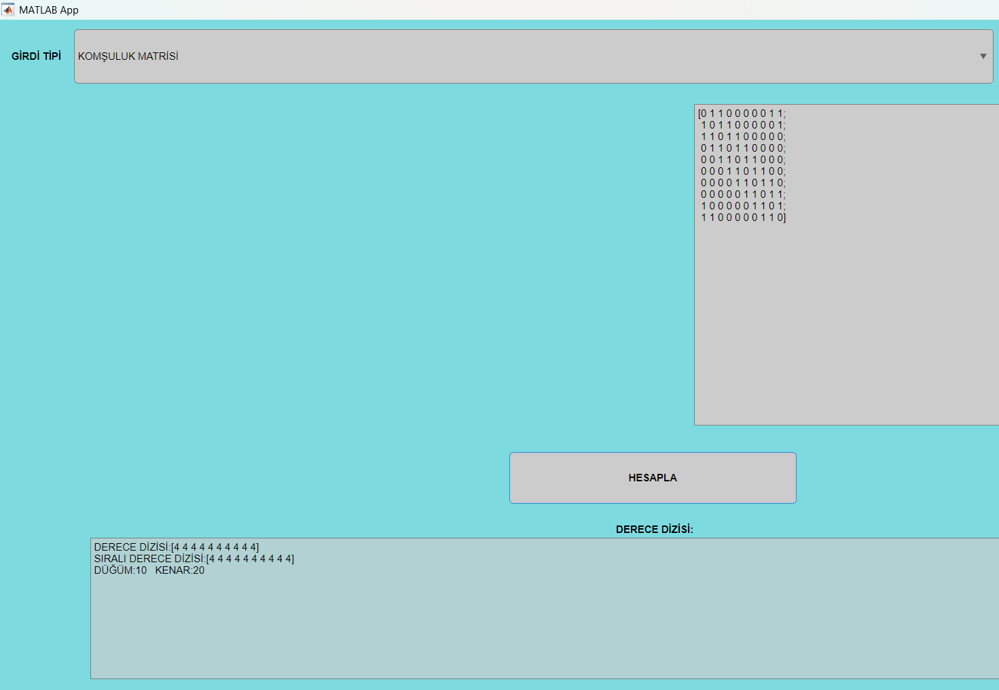
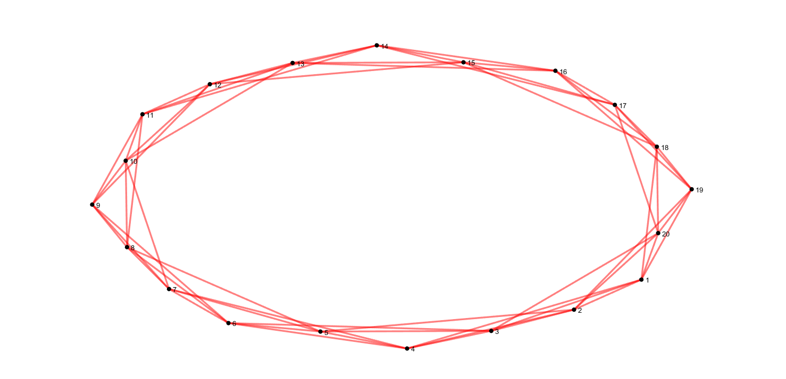
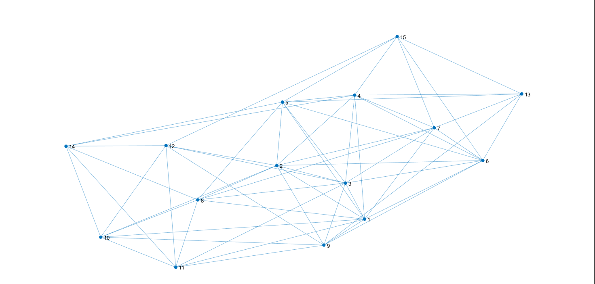
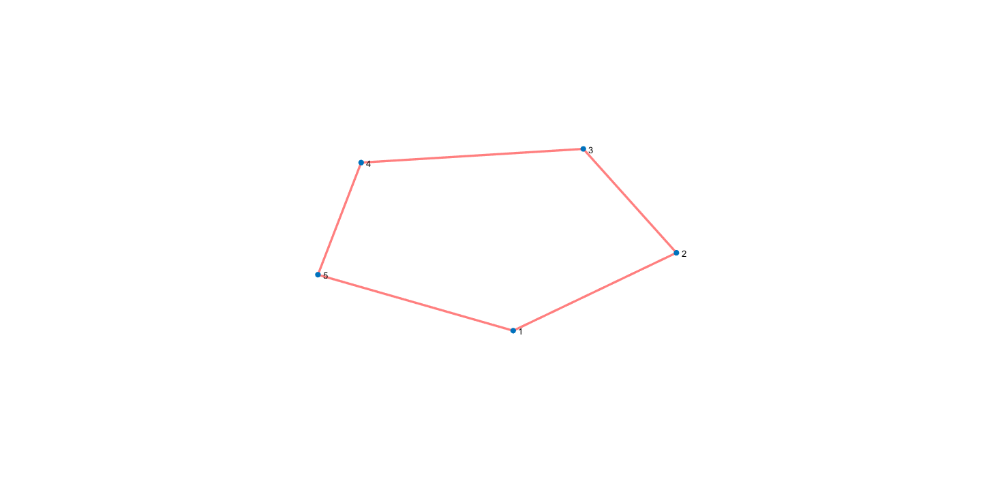

# Graph Theory Algorithms and Visualization in MATLAB

A collection of MATLAB programs for analyzing **undirected graphs**, finding **Eulerian and Hamiltonian cycles**, testing **graphical degree sequences**, and exploring graph properties through an **App Designer GUI**.

The project combines graph-theoretic conditions with algorithmic search and visualization.

## Contents

| File | Purpose | Approach |
| --- | --- | --- |
| `hamilton.m` | Determine whether a simple graph has a Hamiltonian cycle and display a cycle when found | Degree and connectivity checks, Dirac's theorem, iterative backtracking |
| `euler2.m` | Check for an Eulerian circuit and construct one | Even-degree and connectivity checks, Hierholzer's algorithm |
| `havel_hakimi.m` | Determine whether a degree sequence is graphical and construct a corresponding graph | Havel–Hakimi reduction |
| `graph_to_degree.mlapp` | Analyze a graph from an adjacency matrix or edge endpoint lists | MATLAB App Designer, `graph`, `degree` |

## 1. Hamiltonian Cycle — `hamilton.m`

A **Hamiltonian cycle** visits every vertex exactly once before returning to the starting vertex.

The program validates a simple undirected graph's adjacency matrix, rejects graphs with a vertex of degree below 2, checks connectivity, and evaluates **Dirac's sufficient condition**: for a simple graph with $n \geq 3$, if every vertex has degree at least $n/2$, the graph is Hamiltonian. When this condition does not hold, Hamiltonicity remains undecided by the theorem alone.

The program then uses **iterative backtracking** to search for a cycle, recording visited vertices and alternative neighbor choices. When a cycle is found, it displays the vertex order and highlights its edges in a MATLAB graph plot.

**Example input** (enter at the MATLAB prompt):

```matlab
[0 1 0 0 1; 1 0 1 0 0; 0 1 0 1 0; 0 0 1 0 1; 1 0 0 1 0]
```

This represents the five-vertex cycle $1 \to 2 \to 3 \to 4 \to 5 \to 1$.

## 2. Eulerian Circuit — `euler2.m`

An **Eulerian circuit** is a closed trail that uses every edge exactly once.

For a graph with edges, the implementation checks whether all non-isolated vertices belong to the same connected component and whether every vertex has even degree. It then applies **Hierholzer's algorithm**, removing traversed edges from a working adjacency matrix and assembling the circuit using a stack.

The circuit is printed as a vertex sequence and its edges are highlighted on the graph.

**Example input:**

```matlab
[0 1 0 0 1; 1 0 1 0 0; 0 1 0 1 0; 0 0 1 0 1; 1 0 0 1 0]
```

The five-vertex cycle is both Eulerian and Hamiltonian.

## 3. Havel–Hakimi Algorithm — `havel_hakimi.m`

A degree sequence is **graphical** if it can be realized by a simple undirected graph.

The program validates the input, including nonnegative integer degrees, an even degree sum, and the maximum possible degree. It repeatedly sorts the remaining degrees, removes the largest degree $d$, and subtracts one from the next $d$ degrees. During reduction, it records edges to construct and plot a realization when successful.

**Example input:**

```matlab
[3 3 2 2 2]
```

The sequence is graphical; the program constructs one possible graph.

## 4. Graph Degree Analyzer — `graph_to_degree.mlapp`

A graphical application built with **MATLAB App Designer**. It supports two input modes:

- **Adjacency matrix:** enter a square, symmetric, binary matrix with a zero diagonal.
- **Vertex endpoint lists:** enter matching lists of edge start and end vertices (positive integer vertex labels, without self-loops).

The app calculates the **degree sequence**, **degree sequence sorted in descending order**, **number of vertices**, and **number of edges**. Validation errors are shown in the app interface.

Example adjacency-matrix input:

```matlab
[0 1 1; 1 0 1; 1 1 0]
```

This graph has degree sequence `[2 2 2]`, three vertices, and three edges.

## How to Run

1. Open MATLAB and download or clone this repository.
2. Set the MATLAB **Current Folder** to the directory containing the files.
3. Open and run `hamilton.m`, `euler2.m`, or `havel_hakimi.m` in the MATLAB Editor.
4. When prompted in the **Command Window**, enter an adjacency matrix or degree sequence using MATLAB bracket notation.
5. To use the graphical app, open `graph_to_degree.mlapp` in **App Designer** and run it.

The scripts use MATLAB's `graph`, `plot`, and `highlight` functionality. A MATLAB installation supporting these features and App Designer is required for the relevant programs.

## Implementation Notes

- The scripts focus on **simple, undirected graphs**.
- The Hamiltonian search uses backtracking, which can require exponential time on difficult inputs.
- Dirac's theorem is **sufficient, not necessary**; failure to satisfy it does not prove a graph is non-Hamiltonian.
- The Euler implementation searches for a **closed Eulerian circuit**, not an open Eulerian trail.
- The programs are educational implementations; automated test coverage and MATLAB-version compatibility have not yet been documented.

## Author

**Mehmet Ali Sayan**  
GitHub: [@syndevntech](https://github.com/syndevntech)

---

## Project Demonstrations

The following screenshots show example outputs generated by the MATLAB programs.

### Graph Degree Calculator

The App Designer interface analyzes a 10-vertex, 20-edge graph and reports its degree sequence.



### Eulerian Circuit

Visualization of an Eulerian circuit in a connected graph with 20 vertices and 60 edges, using Hierholzer's algorithm.



### Havel–Hakimi Graph Construction

A graphical realization of a degree sequence using the Havel–Hakimi algorithm.



### Hamiltonian Cycle

Visualization of a five-vertex Hamiltonian cycle found using backtracking.


